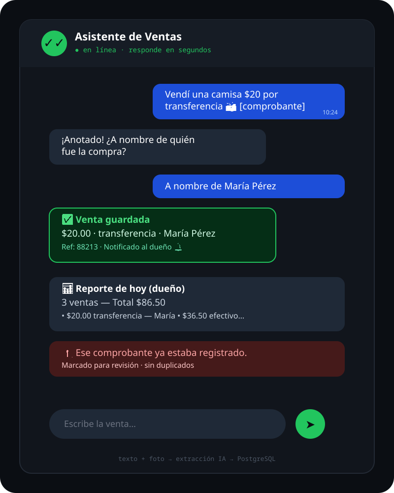
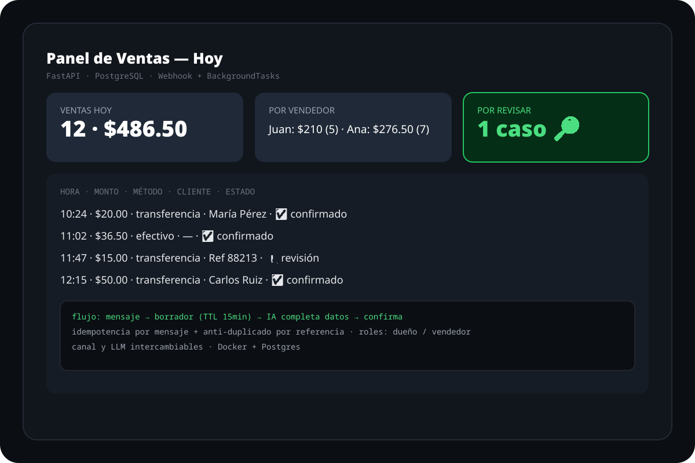

# bot_ventas — Asistente conversacional para registro de ventas

Los vendedores registran ventas por mensaje de texto o foto del comprobante.
El asistente completa los datos faltantes con preguntas, evita duplicados y
guarda todo en PostgreSQL. El dueño puede pedir reportes y recibe avisos
automáticos de cada venta.

## Capturas (mockups)




## Puesta en marcha

```bash
psql $DATABASE_URL -f app/schema.sql
cp .env.example .env   # completa tus claves
uv run --with-requirements requirements.txt uvicorn app.main:app
# o con Docker: docker compose up --build
```

## Cómo funciona

- **Canal de entrada intercambiable** (`INPUT_PROVIDER=whatsapp|telegram`):
  `app/channels.py:INPUTS` — agrega tu clase con `parse_webhook/send_text/fetch_media`.
- **LLM intercambiable** (`LLM_PROVIDER=gemini|groq|openrouter|stub`):
  `app/llms.py:LLMS` — agrega tu clase con `extract(draft, text, image, mime)`.
- **Máquina de estados** (`app/service.py`): fusiona mensajes en un borrador con
  TTL, pregunta solo lo que falta (monto, método de pago, cliente, referencia),
  confirma y notifica al dueño.
- **Sin duplicados**: idempotencia por mensaje + detección por referencia de pago.
- El webhook responde 200 de inmediato y procesa en `BackgroundTasks`.

## Estructura

```
app/          FastAPI + canales + LLMs + máquina de estados + schema SQL
tests/        self-check sin Postgres (swappability + flujo de borrador)
compose.yaml  Postgres 16 + app (Docker)
```

## Variables de entorno

Ver `.env.example`: `DATABASE_URL`, `META_VERIFY_TOKEN`,
`GEMINI_API_KEY` / `GROQ_API_KEY` / `OPENROUTER_API_KEY`,
`INPUT_PROVIDER`, `LLM_PROVIDER`, `DRAFT_TTL_MINUTES`.
